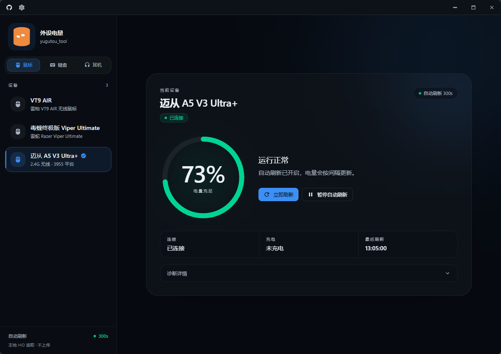

# Yugutou Tool

一款基于 **[Native Shell (NSH)](https://nsh.dev) + Rust** 构建的 Windows 桌面工具，专注于无线鼠标电量监控。

通过 HID 协议直接读取设备电量，无需依赖厂商控制软件常驻运行。采用模块化设备插件架构，将鼠标协议适配与应用核心功能解耦，让新设备的接入更加清晰、简单。

> 当前分支已从 Tauri + React 迁到 NSH mixed 模式（Rust crate + TSX 界面），托盘常驻内存约 18 MB（旧版约 190 MB）。Tauri 旧代码已删除，需要时可从提交 `aa6f6d5` 找回。新旧功能对比见 [todoList.md](todoList.md)。

仓库：[wjyugutou/mouse_tool](https://github.com/wjyugutou/mouse_tool)



## ✨ 核心特性

- **🔋 电量监控**：通过 HID 协议读取支持设备的电量信息。
- **🖱️ 多设备支持**：目前支持雷柏 VT9 AIR、雷蛇毒蝰终极版（Viper Ultimate）、迈从 A5 V3 Ultra+、前行者 S9 Pro，以及 VGN S99 键盘。
- **📌 系统托盘**：在托盘中查看设备电量，快速切换设备与主窗口。
- **🎨 个性化设置**：支持主题、刷新间隔、关闭窗口行为及开机自启。
- **🧩 插件化架构**：构建期设备插件，设备适配器、HID 协议实现与应用核心解耦。
- **📝 运行日志**：优先写安装目录 `logs/mouse_tool.log`，无写权限则回退 AppData。

## 🛠️ 技术栈

- **桌面框架**：[Native Shell](https://nsh.dev)（mixed 模式，`nsh.json` 里 `"rust": "native"`）
- **界面**：TSX（NSH 运行时，signals）
- **后端**：Rust（`nsh-core` 原生模块 `yugutou/native`）
- **设备通信**：HID（`hidapi`）

## 🚀 开发与运行

环境要求：Windows、Node.js、Rust；pnpm 可选。**不需要全局安装 nsh**：`nsh` 是独立的命令行工具（不是 Cargo 依赖），版本写在 `package.json` 的 `nshVersion`（当前 v0.6.1，CI 读同一处）。首次运行任一 `pnpm` 脚本时，`scripts/nsh.mjs` 用官方安装脚本把它下载到仓库内的 `.tools/nsh`（已 gitignore），版本不符时自动重装，并保持用户 PATH 不变。

所有命令在仓库根目录执行：

```powershell
pnpm dev             # nsh run，开发运行
pnpm check           # 类型检查 TSX + 编译 Rust
pnpm test            # Rust 单元测试 + UI 测试（app.test.tsx）
node scripts/nsh.mjs <args>   # 直接用 nsh 的其它命令，例如 node scripts/nsh.mjs --version
```

## 📁 本地打包

```powershell
pnpm build      # nsh build --release
pnpm package    # nsh package --target windows --icon assets/icon.png
```

产物在 `.nsh/out/`：程序目录、zip、更新用的 `yugutou-tool-<版本>-windows-x86_64.zip` 和 Inno Setup 脚本 `yugutou_tool.iss`。装了 [Inno Setup 6](https://jrsoftware.org/isinfo.php) 时同时出 `yugutou_tool-setup.exe`（按用户安装到 `%LOCALAPPDATA%\Programs\yugutou_tool`，不需要管理员，应用内更新才能覆盖安装目录）。

`package.json` 只放脚本、没有依赖，`pnpm install` 不需要跑；没有 pnpm 时直接 `node scripts/<脚本>.mjs` 也一样。

## 🚢 发版与自动更新

1. `pnpm release:bump 3.6.0`（先加 `--dry-run` 看会改什么）：工作区要干净；改 `nsh.json`（version，build + 1）、`native/Cargo.toml`、`native/Cargo.lock`，生成 `docs/releases/v3.6.0.md`，提交 `chore: 版本 bump 至 3.6.0`，打 tag `v3.6.0`，推送分支和 tag。
2. GitHub Actions `Release`（`.github/workflows/release.yml`）收到 `v*` tag 后在 windows-latest 上：装 nsh CLI → 校验版本与 tag 一致 → `nsh check` / `nsh test` / `nsh build --release` → `nsh package` → Inno Setup 出安装包 → `nsh update-manifest` 生成并签名 `latest.json` / `latest.json.sig` → 发布 GitHub Release（安装包、更新 zip、清单）。
3. 应用（`src/updater.ts`，`nsh/updater`）启动 15 秒后和每 6 小时自动检查一次；设置页「应用更新」可手动检查、下载并安装，托盘菜单在有新版本时多一项「安装更新」。下载按清单校验 SHA-256，清单用 `nsh.json` 里的 `updater.publicKey` 验签，安装后自动重启。

更新清单：`https://github.com/wjyugutou/mouse_tool/releases/latest/download/latest.json`。Latest Release 必须带 `latest.json`，草稿和预发布不会被检查到。

**GitHub Secrets**（仓库 Settings → Secrets and variables → Actions）：

| 名称 | 内容 |
| --- | --- |
| `NSH_UPDATE_KEY` | `nsh keygen` 生成的 `.secret` 文件的全部内容（签名 `latest.json`）；本机放在仓库外的 `D:\DEV\keys\yugutou\yugutou-update.secret` |

`GITHUB_TOKEN` 由 Actions 自动提供，不用添加。签名私钥不入库（`.gitignore` 忽略 `*.secret`），公钥写在 `nsh.json` 的 `updater.publicKey`；换密钥要同时改这两处，且旧版本只认旧公钥。

## 📦 下载安装

前往 [GitHub Releases](https://github.com/wjyugutou/mouse_tool/releases) 下载 `yugutou_tool-<版本>-setup.exe`。旧版 Tauri（MSI）不能应用内直接升级到 NSH 版，需要手动安装一次新版（见 todoList.md）。

## 🧩 扩展设备支持

每款设备一个 Rust 文件，实现插件契约并在注册表追加一行；界面从注册表读取设备列表，无需改主窗口、设置页和托盘。

- 契约：`native/src/plugin_sdk.rs`（`DevicePlugin` / `BatteryInfo`）
- 实现：`native/src/devices/<id>.rs`，在 `devices/mod.rs` 的 `PLUGINS` 注册
- 元数据：`native/manifests/<id>.json`（`include_str!` 编进二进制）

详细说明请参阅 [设备插件开发指南](docs/plugin-development.md)。

### 已注册设备

| 插件 id                   | 名称                      | 说明                                                                                                                                                                                                                                                                                                                                                                                                                                                                                                                                  |
| ------------------------- | ------------------------- | ------------------------------------------------------------------------------------------------------------------------------------------------------------------------------------------------------------------------------------------------------------------------------------------------------------------------------------------------------------------------------------------------------------------------------------------------------------------------------------------------------------------------------------- |
| `vt9-air`                 | VT9 AIR                   | 雷柏 VT9 AIR；被动中断读 HID 电量（Report `0xBB`）。不要对它用 GetInputReport / Feature，会卡鼠标                                                                                                                                                                                                                                                                                                                                                                                                                                     |
| `razer-viper-ultimate`    | 毒蝰终极版 Viper Ultimate | 有线 `1532:007A` / 接收器 `1532:007B`；OpenRazer Feature（class `0x07` / cmd `0x80`）；充电状态同族命令 `0x84`                                                                                                                                                                                                                                                                                                                                                                                                                        |
| `mchose-a5-v3-ultra-plus` | 迈从 A5 V3 Ultra+         | 2.4G 无线 · 3955 平台                                                                                                                                                                                                                                                                                                                                                                                                                                                                                                                 |
| `vgn-s99`                 | VGN S99                   | 2.4G 无线机械键盘（首只 `keyboard` 分类）。接收器 `320F:5088` 的 `0xFF1C` 厂商接口，Output 报文 Report ID `0x04` + 命令 `0x1A` 查询，Input 中断读回。**不要用 Feature 报告**：该接口描述符无 `B1` 项，`HidD_SetFeature` 恒返回 `0x1`。HID 可能被 VGN VHUB 独占                                                                                                                                                                                                                                                                        |
| `qianxingzhe-s9-pro`      | 前行者 S9 Pro             | 2.4G 无线鼠标。VID `372E`（IPI/PIAO，`ms_pix_v1` 协议），接收器 `372E:103D` 的 `0xFF00` 厂商接口走 **Feature 报告**（Report ID `0x03`，payload 63 B），命令 `get_basic_info`（`0x4F/0x81`，首字节 CRC = `sum(payload[1..]) % 256`），**电量 = 回包 `buf[6]`**。首读可能只有 5 字节状态桩，必须重读；充电时该字段是哨兵值 `0xE4`(228)，拿不到百分比。**只读电量**，不做 DPI / 灯光 / 宏。只支持 S9 系列（Pro `0x1029`；Ultra `0x1027`、Max `0x105E` 会明确拒绝冒充）；2.4G 接收器 PID `1026/1033/103D/1055` 由三型号共用，无法区分型号 |

## 🏗️ 项目结构

- `nsh.json` — 应用清单（窗口、主题、版本）
- `App.tsx`、`src/` — TSX 界面（首页、设置、侧栏、标题栏、托盘状态）
- `native/src/lib.rs` — 原生模块 `Mouse`（导出给 TSX 的接口）
- `native/src/hub.rs` — 设备轮询与电量快照
- `native/src/devices/` — 插件注册表与各设备 HID 实现
- `native/src/settings.rs`、`autostart.rs`、`app_log.rs`、`tray_icon.rs` — 设置、开机自启、日志、托盘图标
- `tools/hid-probe/` — 独立 HID 探针 crate（协议调试用，不参与应用构建）

## 📄 许可证

本项目采用 [MIT License](LICENSE) 开源。
