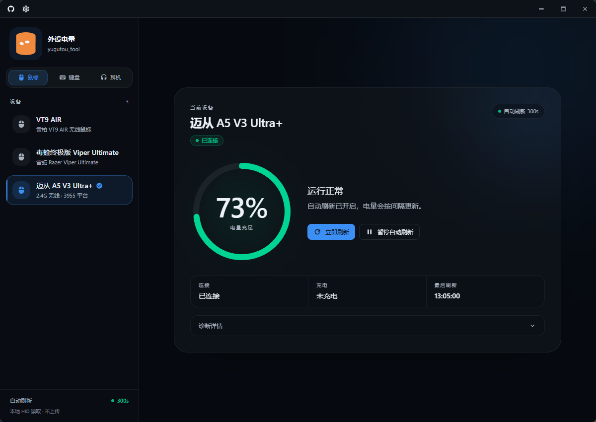

# Yugutou Tool

一款基于 **Tauri + React + Rust** 构建的 Windows 桌面工具，专注于无线鼠标电量监控。

通过 HID 协议直接读取设备电量，无需依赖厂商控制软件常驻运行。采用模块化设备插件架构，将鼠标协议适配与应用核心功能解耦，让新设备的接入更加清晰、简单。

仓库：[wjyugutou/mouse_tool](https://github.com/wjyugutou/mouse_tool)



## ✨ 核心特性

- **🔋 电量监控**：通过 HID 协议读取支持设备的电量信息。
- **🖱️ 多设备支持**：目前支持雷柏 VT9 AIR、雷蛇毒蝰终极版（Viper Ultimate）、迈从 A5 V3 Ultra+。
- **📌 系统托盘**：在托盘中查看设备电量，快速切换设备与主窗口。
- **⚙️ 个性化设置**：支持主题、刷新间隔、关闭窗口行为及开机自启。
- **🔄 自动更新**：集成 Tauri Updater，通过 GitHub Releases 检查和安装新版本。
- **🧩 插件化架构**：采用构建期设备插件设计，将设备适配器、HID 协议实现与应用核心解耦，便于扩展更多鼠标型号。
- **📝 运行日志**：记录应用运行信息，便于问题排查与设备协议调试（优先写安装目录 `logs/mouse_tool.log`，无写权限则回退 AppData）。

## 🛠️ 技术栈

- **桌面框架**：[Tauri 2](https://tauri.app/)
- **前端**：[React](https://react.dev/) + TypeScript
- **后端**：[Rust](https://www.rust-lang.org/)
- **设备通信**：HID
- **包管理**：pnpm
- **持续集成与发布**：GitHub Actions

## 🚀 开发与运行

环境要求：Windows、Node.js（建议 LTS）、pnpm、Rust。

```powershell
pnpm install
pnpm dev:app
```

仅启动前端开发服务器（默认 http://localhost:1420）：

```powershell
pnpm dev
```

## 📦 下载安装

前往 [GitHub Releases](https://github.com/wjyugutou/mouse_tool/releases) 下载 Windows 安装包。

## 🔢 版本号

改 `package.json` 的 `version` 后执行：

```powershell
pnpm version:sync
```

会同步到 `src-tauri/tauri.conf.json`、`src-tauri/Cargo.toml` 与 `src-tauri/Cargo.lock`。`pnpm build` / `pnpm build:app` 也会先跑同步。

发版（工作区需干净）：

```powershell
pnpm release:bump 2.0.3
```

脚本会写入上述版本文件，提交 `chore: 版本 bump 至 2.0.3`，打 tag `v2.0.3`，并推送当前分支和这个 tag。

## 📁 本地打包

签名私钥放在项目目录（已 gitignore，勿提交）：

`mouse_tool_updater_keys/mouse_tool.key`

密码默认：`mousetool`

```powershell
pnpm build:app
```

产物在 `src-tauri/target/release/bundle/msi/`（当前只打 MSI，文件名形如 `yugutou_tool_{version}_x64_zh-CN.msi`）。

## 🚢 发版（自动更新）

1. `pnpm release:bump 2.0.3`：改版本、提交、打 tag `v2.0.3` 并推送
2. GitHub Actions `Release` 在收到 `v*` tag 后构建并上传 MSI、`latest.json`、`.sig`
3. Secrets：`TAURI_SIGNING_PRIVATE_KEY`、`TAURI_SIGNING_PRIVATE_KEY_PASSWORD`

更新清单：

`https://github.com/wjyugutou/mouse_tool/releases/latest/download/latest.json`

**Latest Release 必须带** `latest.json`；空的 Latest 或长期 Draft 会导致应用内检查失败。

## 🧩 扩展设备支持

项目采用构建期设备插件架构。每款鼠标通过前端 `DeviceAdapter` 和对应的 Rust HID 实现接入，并通过统一的插件契约注册。

- 前端：`src/plugins/<id>/`（含 `manifest.json`）
- 后端：`src-tauri/src/devices/<id>.rs`，并在 `PLUGINS` 注册表追加一行

窗口、设置、托盘、日志、自动更新留在壳层。命令在 `generate_handler!` 里静态注册，不加载 DLL。电量只有一条壳层命令：`get_battery(device_id)`；`device_id` 与前端适配器的 `id` 来自同一份 `manifest.json`。

新增设备时，无需重写主窗口、设置页、托盘和自动更新等核心功能。详细说明请参阅 [设备插件开发指南](docs/plugin-development.md)。

### 已注册设备

| 插件 id | 名称 | 说明 |
| --- | --- | --- |
| `vt9-air` | VT9 AIR | 雷柏 VT9 AIR；被动中断读 HID 电量（Report `0xBB`）。不要对它用 GetInputReport / Feature，会卡鼠标 |
| `razer-viper-ultimate` | 毒蝰终极版 Viper Ultimate | 有线 `1532:007A` / 接收器 `1532:007B`；OpenRazer Feature（class `0x07` / cmd `0x80`）；充电状态同族命令 `0x84` |
| `mchose-a5-v3-ultra-plus` | 迈从 A5 V3 Ultra+ | 2.4G 无线 · 3955 平台 |

## 🏗️ 项目结构

- `src-tauri/src/plugin_sdk.rs` — 插件契约（`DevicePlugin` / `BatteryInfo`）
- `src-tauri/src/devices/` — 插件注册表与各鼠标的 HID 实现
- `src-tauri/src/tray.rs` — 托盘壳（设备列表来自插件表）
- `src-tauri/src/app_log.rs` — 文件日志
- `src-tauri/src/lib.rs` — 启动与命令注册
- `src/plugin-sdk/` — 前端契约与 `createDeviceAdapter`
- `src/plugins/` — 已安装的设备插件
- `src/devices/` — 壳层重新导出，页面继续从这里取注册表

## 📄 许可证

本项目采用 [MIT License](LICENSE) 开源。